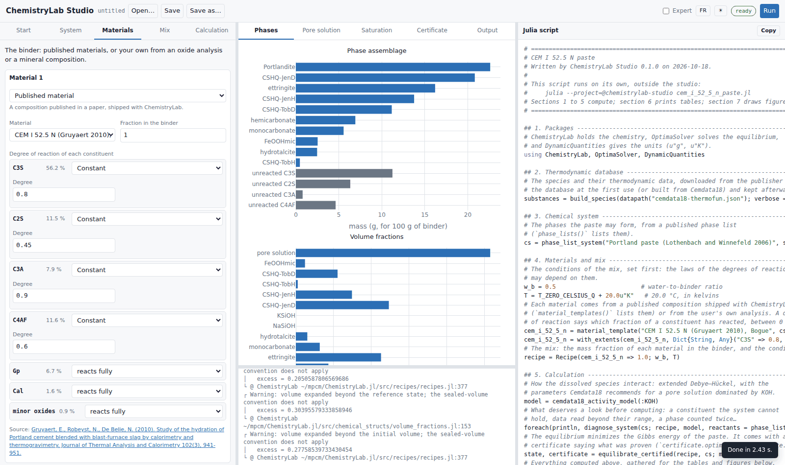
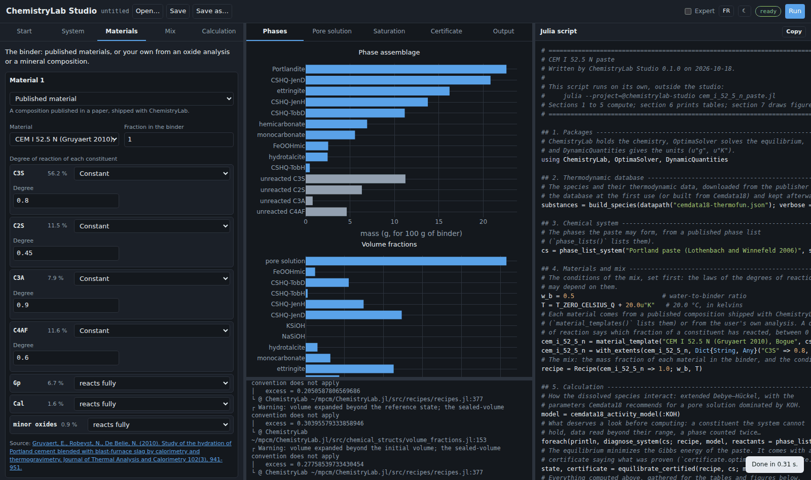

# [Starting ChemistryLab Studio](@id studio-start)

ChemistryLab Studio is a graphical interface for cementitious materials. It
runs in your web browser, on your own machine: you build a calculation with
forms, run it, read its plots and tables, and get the Julia script that does
the same calculation on its own. No programming is needed to use it, and the
script it writes is a way to learn.

```@raw html


```

## What you need

- Julia 1.12 or later, installed with juliaup, the Julia installer.
- A web browser.

## Installing and starting

In a Julia session (the REPL), type `]` to enter the package mode, then add
the studio once:

```julia-repl
pkg> add ChemistryLabStudio
```

Press Backspace to leave the package mode. Each time you want the studio:

```julia-repl
julia> using ChemistryLabStudio

julia> clstudio()
ChemistryLab Studio → http://127.0.0.1:8766/?token=…
```

The browser opens on the studio. The Julia session stays busy while the
studio runs; press Ctrl-C in it to stop the studio.

## What happens the first time

The calculations do not run in your Julia session but in a second Julia
process, in an environment of its own named `@chemistrylab-studio`. The page
opens at once and shows, under *Getting ready*, what is being done:

1. **The environment is prepared**, once: ChemistryLab, its equilibrium solver
   OptimaSolver, DynamicQuantities for the units, OrdinaryDiffEq for the
   kinetic runs and Plots for the figures of the scripts. On a fresh installation this downloads and compiles them, which
   takes several minutes; it is much shorter when they are already installed.
2. **The thermodynamic database is downloaded** from its publisher, once, and
   kept on your machine.
3. **The first calculation is compiled**, at each start of the studio, which
   takes from under a minute to a few minutes depending on the machine. Later
   calculations of the same kind take a fraction of a second.

You can fill in the forms meanwhile. The badge at the top right turns green
(*ready*) when a calculation can run.

## Options

| Option | What it does |
| --- | --- |
| `port` | The port to listen on. Without it the studio takes 8766, or the next free port when 8766 is taken. A port you name is used, or refused with a message. |
| `host` | Where to listen, `"127.0.0.1"` by default: only this machine reaches the studio. |
| `no_browser = true` | Do not open the browser; the address is printed. |
| `project` | The environment the calculations run in, a folder or `@name`. By default the studio's own, which it creates and keeps. An environment named this way is checked, never modified. The `CLSTUDIO_PROJECT` environment variable does the same. |
| `julia` | The Julia program of the calculations, if it is not the one running. |
| `check = true` | Prepare and check the environment of the calculations, print what it holds, and stop. |
| `wait = false` | Return at once, the studio running: `h = clstudio(wait = false)`, then `close(h)` stops it. |
| `update = true` | Update the packages of the studio's environment before starting. |

## The address and its token

The address ends with `?token=…`, a random key drawn at each start. The page
sends it back with every request, and the studio refuses any request without
it: the studio runs Julia code on request, so no other web page you visit, and
no other user of the machine, may talk to it. Do not share the address.

## On a remote machine

When Julia runs on another machine (over SSH, or in a VS Code remote window),
the studio prints its address instead of opening a browser. Open it in the
browser of your own machine:

- **VS Code** forwards the port by itself: click the address in the terminal.
- **SSH**: forward the port when you connect, then open the address locally:

  ```bash
  ssh -L 8766:127.0.0.1:8766 user@machine
  ```

## Running a saved script without the studio

A script the studio saved runs in the studio's environment, in a terminal:

```bash
julia --project=@chemistrylab-studio my_study.jl
```

It prints its tables and saves its figure next to itself.

## When something goes wrong

| What you see | What to do |
| --- | --- |
| The badge stays on *preparing* or *starting* | Watch the log under the results: it shows what is being installed or compiled. |
| *failed*, with a message | Read the message; `clstudio(check = true)` in a Julia session diagnoses the environment. The *Restart* button tries again. |
| *Only … GB of memory are free* | The studio refuses to start a calculation that could exhaust the machine's memory. Close other programs, then run again. |
| *The calculation was stopped: it needed more than …* | The calculation outgrew the memory the machine can spare and was stopped. Make it smaller. |
| A database is unavailable | The message says where to download the file and how to install it. |
| *port … is already in use* | Another program uses that port: start with another one, `clstudio(port = 9000)`. |
| The packages are old | `clstudio(update = true)`. |

## Reference

```@docs
clstudio
```
