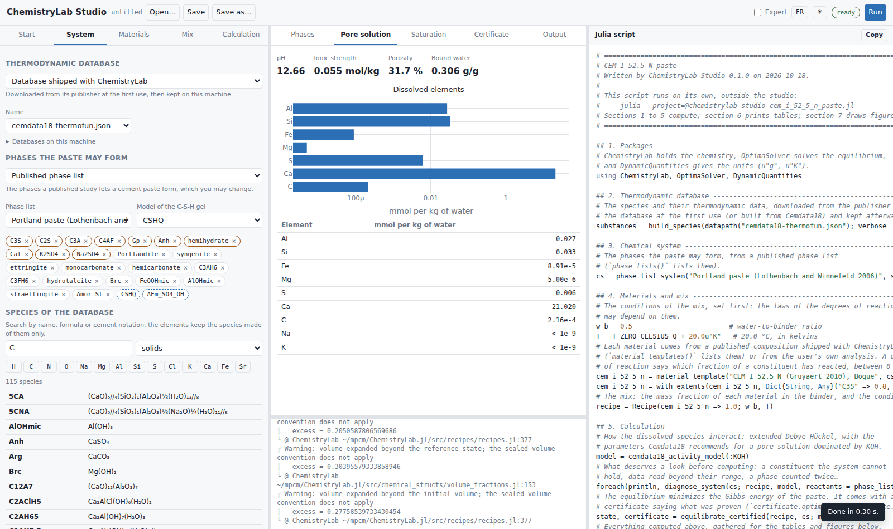
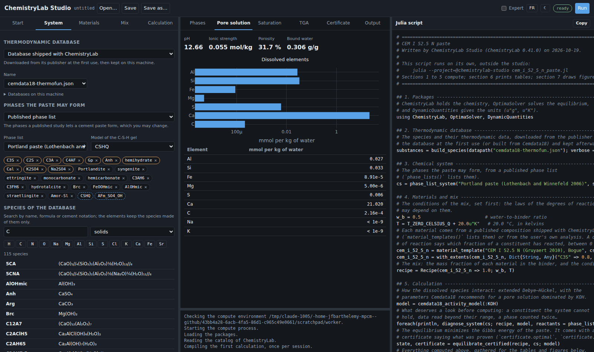
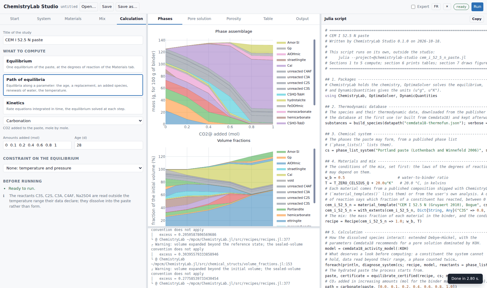
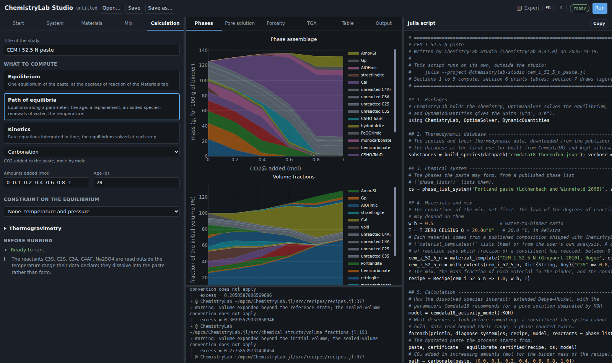
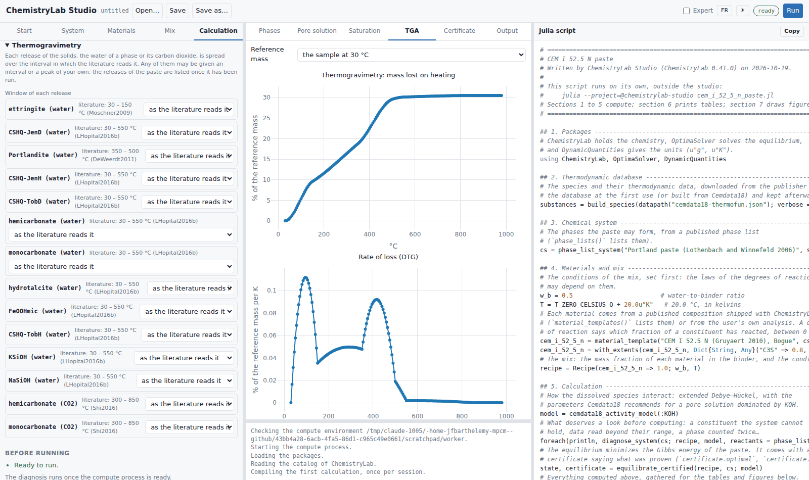
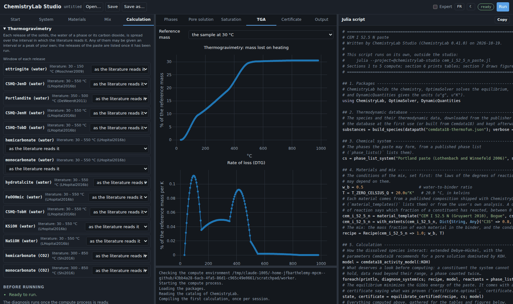
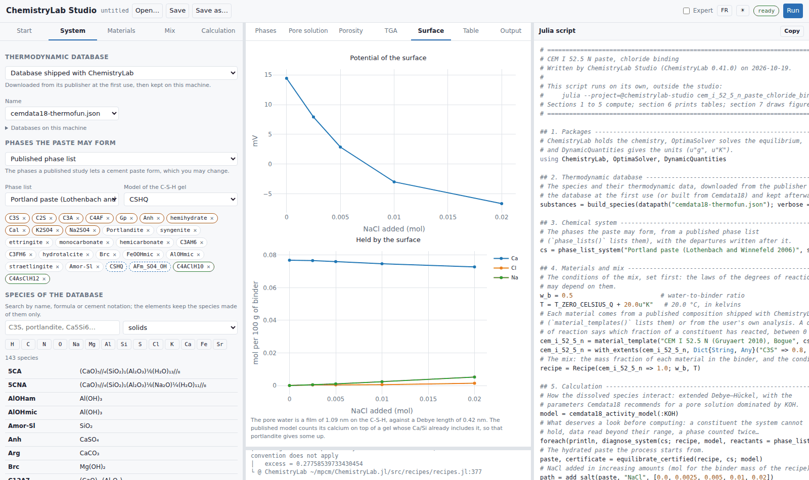
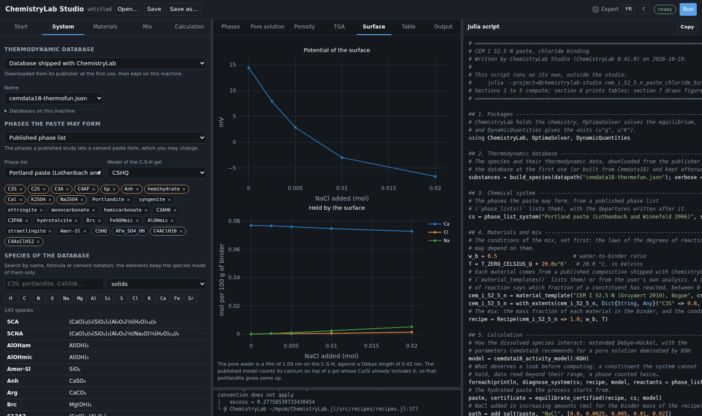
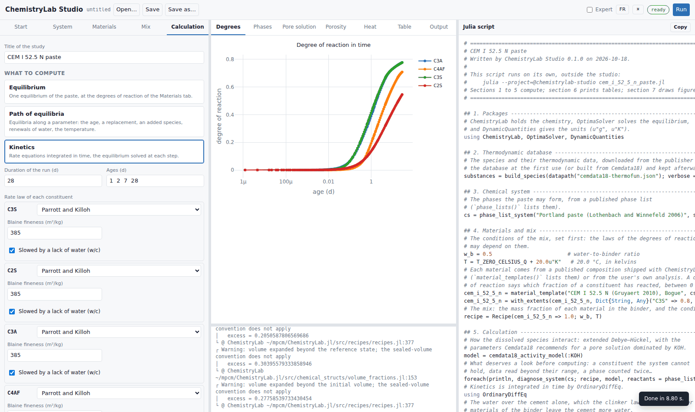
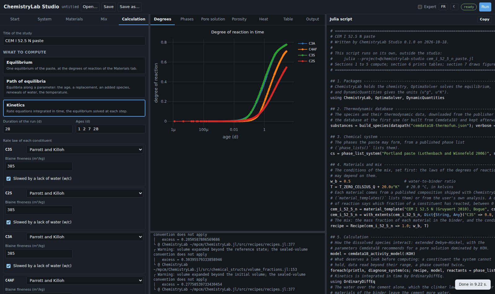

# Using the studio

The studio shows three panels side by side: on the left, the steps of a
calculation in tabs; in the middle, the results; on the right, the Julia script
the studio writes as you go. The panels can be resized by dragging their
borders.

```@raw html


```

The header holds the file buttons, the *Expert* switch, the language (English
or French), the theme (as the system, light or dark), the status of the
calculations and the *Run* button.

## The tabs, in order

**Start.** The [library](@ref studio-library) of published formulations, each
loaded with one click, and *Open a script* for a script you saved.

**System.** Everything the equilibrium is made of:

- the thermodynamic database: one shipped with ChemistryLab (Cemdata18 by
  default), or a file of your own;
- the phases the paste may form: a published phase list, whose phases appear
  as chips (× leaves one out, ↺ takes it back), or a list of your own with the
  solid solutions you choose; the C-S-H gel model is chosen here;
- the species of the database: search by name, formula or cement notation
  (`C3S`, `Portlandite`, `CaCO3`), click elements to keep the species made of
  them only, and add a solid to the system with **+**; a ⚠ marks a species
  whose data do not cover the temperature of the mix;
- the activity model of the pore solution;
- the **surface of the C-S-H**: the sites of the published model of
  [Guo2018](@citet) on the gel, computed after the equilibrium (or at each
  point of a path) by [`with_csh_surface`](@ref): the gel is frozen at its
  composition, portlandite holding the activities it shares with it, and the
  paste is solved again with the sites. Along an addition of salt, that is the
  binding of chloride by the surface beside the chloride AFm phases. In expert
  mode a Donnan layer of water can be put on the diffuse layer, as in a
  suspension: it is refused, with the reason, when the pore water is a film
  thinner than the layer or than the Debye length, which is the case of a
  hardened paste;
- the **diagnosis**, kept up to date as you edit, which reports what
  [`diagnose_system`](@ref) finds: a constituent the system cannot hold, a
  phase declared twice, data read outside their temperature range, the Al-Si
  hydrogarnets of Cemdata18, missing volumes or enthalpies. Each finding says
  what it costs and what to do.

```@raw html


```

**Materials.** The binder, one card per material: a published composition
shipped with ChemistryLab, an oxide analysis of yours (by Bogue's calculation,
or kept as oxides), or a mineral composition of yours. A composition is
entered in a table; *Paste…* reads a block copied from a spreadsheet or a CSV
file (tabs, semicolons or commas, a decimal comma accepted), shows how each
line was read, and adds the rows; *Copy* puts the table back on the clipboard;
Ctrl-Z undoes the last change. Each constituent can be given a degree of
reaction: constant, a logistic law in time, a table of measurements, the law of
Parrott and Killoh, or any of these capped.

**Mix.** The water-to-binder ratio and the temperature; in expert mode, the
mass of binder and the pressure.

**Calculation.** Three buttons choose what to compute:

- **Equilibrium**: one equilibrium of the paste, its degrees of reaction read
  at the age given;
- **Path of equilibria**: equilibria along a parameter, each started from the
  previous one: the age (hydration), the fraction of a replacing material, CO₂,
  a salt or any species added, renewals of pure water (leaching) or of an
  attacking solution, a range of temperatures or of water-to-binder ratios;
- **Kinetics**: rate laws integrated in time. Each constituent given a law
  reacts as the law says (Parrott and Killoh for the clinker phases, Waller for
  a fly ash or a silica fume, a first-order law, or a law you write as a Julia
  expression); the others are at equilibrium, to their degree of reaction, from
  the start. A glass (a slag, the glass of a fly ash), known by its oxides, can
  be given a law too: the script writes it a formula from its oxides, with an
  enthalpy of formation estimated from them so that its heat counts
  ([`with_glass_species`](@ref)). The run is isothermal or in a semi-adiabatic
  cell, whose losses are linear in the difference of temperature or, in expert
  mode, with the quadratic term of a calibration.

A constraint can be put on an equilibrium: a pH held, the activity of a species
held (`CO2@` for a partial pressure of CO₂), saturated curing, or adiabatic
conditions. *Thermogravimetry*, at the end of the tab, sets the window of any
release of the solids (the water of a phase, or its carbon dioxide): an
interval, or a logistic peak, in place of the interval in which the literature
reads it. The releases of the paste are listed once it has been run, each with
the literature's interval beside it. *Before running* lists what keeps the
model from running; *Run* stays disabled until the list is empty.

## The results

The tabs of the middle panel follow the calculation:

- **Phases**: the mass of each solid for the mass of binder, and the volume
  fractions, the pore solution and the void the chemical shrinkage leaves
  included. What has not reacted is drawn in gray. Along a path or in time,
  the masses and the volumes are stacked areas.
- **Pore solution**: the pH, the ionic strength, the porosity and the bound
  water, and the dissolved elements in mmol per kg of water, on a log axis.
- **Saturation**: the saturation index of each phase.
- **Porosity**: along a path, the porosity and the bound water.
- **Degrees** and **Heat**: for a kinetic run, the degree of reaction of each
  constituent in time, the heat released, and the temperature of a
  semi-adiabatic cell.
- **TGA**: the thermogram of the solids from 30 to 980 °C, the mass lost and
  its rate (DTG), in percent of a reference mass you choose (the sample at
  30 °C, dry at 105, 500 or 800 °C, or ignited), the conventions the papers
  use; for one equilibrium, the loss of each phase. Each loss is spread over
  its window: the interval in which the literature reads it
  ([`literature_windows`](@ref)), unless the Calculation tab sets another. The
  curve says where a loss is attributed, not how a phase decomposes. A table
  lists the window of each release and where it comes from, and *Change the
  windows* opens them in the Calculation tab. Along a path or in time, a list
  chooses the point.
- **Surface**: with the surface of the C-S-H, what its complexes hold per mass
  of binder, its potential, the film of pore water on its area against the
  Debye length, and the Donnan layer; along a path, what it binds and its
  potential at each point.
- **Certificate**: what the solver proved about the equilibrium.
- **Table**: along a path, one row per point; *Copy the table* puts it on the
  clipboard for a spreadsheet.
- **Output**: what the calculation printed, the diagnosis first.

Every plot can be saved as an image from its toolbar.

```@raw html


```

```@raw html


```

```@raw html


```

## The script

The right panel shows the script of the current calculation, rewritten at each
change. It is written for a reader who knows little Julia: seven sections, each
saying what it does. The studio runs sections 1 to 5 itself, so the results on
the page are those of the script, the windows of the thermogram included;
section 6 prints tables (the loss on ignition among them, from the same
windows) and section 7 draws a figure, for the script alone. *Save* writes it to a file; *Copy* puts it on
the clipboard.

The model of the page is embedded at the end of the script, in a comment, so
that *Open* restores every form exactly. A script edited by hand opens with a
warning: the forms come from its embedded model, and saving writes a new file
rather than overwriting the edited one.

```@raw html


```

## Stopping a calculation

While a calculation runs, *Stop* interrupts it. When the interruption cannot
reach it within a few seconds, the compute process is restarted, and the next
calculation compiles again. A calculation that would need more memory than the
machine can spare is refused before it starts, or stopped when it outgrows
it.

## When a run stops short

A kinetic run whose integration ends before its horizon reports the ages it
reached and the reason, in the *Degrees* tab and in a message: the results
shown are those of the ages reached.
